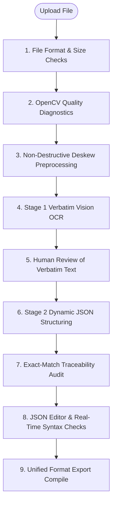

# Nobeth Universal OCR

> **Extract. Understand. Structure.**  
> A standalone, single-server document intelligence workstation powered by **Google Gemini 3.1 Flash-Lite** (with automated **Gemini 3.5 Flash-Lite** failover resilience) and **Streamlit**.
> Features both **Single Document Verification** and high-capacity **Bulk Image & Folder Processing** with sequential execution, live telemetry, individual exports, and complete batch ZIP archives.

[](https://github.com/sankaran-s2001/Nobeth-Universal-OCR)
[](https://python.org)
[](https://opensource.org/licenses/MIT)
[](#-official-nobeth-analytics-branding)

**Nobeth Universal OCR** is a modern, high-accuracy document intelligence workspace designed to extract and structure information from almost any image or document format without rigid, pre-defined templates.

The application operates on a **universal two-stage architecture** combining Computer Vision and LLMs with automated high-availability failover. First, it performs a source-faithful, verbatim extraction of all visible text, tables, and handwriting. Second, it dynamically infers the document type, parses the text into a clean JSON schema, and checks data provenance through exact-match traceability linkages.

---

## 🎯 Aim

The aim of Nobeth Universal OCR is to provide a template-free document processing workstation that supports both **interactive single-document review** and **high-volume bulk image folder processing**. The system converts raw, unformatted scans, PDFs, and images into structured, verified JSON, CSV, and TXT data. It aims to eliminate coordinate-based parsing templates and enable generalized document extraction that works across receipts, invoices, IDs, medical forms, and handwritten logs.

---

## ❗ Problem

Legacy document processing architectures present major challenges:
1. **Coordinate-Based Parsing**: Traditional tools map fields to exact pixel positions. If a vendor changes an invoice layout by a few millimeters, extraction fails.
2. **Layout Variance**: Writing rules for every possible document format (utility bills, ID cards, shipping logs) leads to brittle codebases.
3. **OCR Limitations**: Standard OCR engines return unstructured text wraps without layout landmarks, losing tabular relations and handwriting.
4. **Data Provenance**: Once data is transformed by an AI model, there is no verification that the structured values exist verbatim in the source document, risking hallucination.
5. **Bulk Processing Crashes & Rate Spikes**: Ingesting 50+ images simultaneously can cause cloud memory exhaustion (e.g. Render 512 MB RAM limits) and trigger immediate HTTP 429 quota exhaustion.

---

## 💡 Solution

Nobeth Universal OCR resolves these issues with a **Universal Pipeline** supporting two distinct operational modes:

```text
                               Document Upload
                                      │
                                      ▼
                            Input Mode Selector
                                      │
                 ┌────────────────────┴────────────────────┐
                 ▼                                         ▼
     [Mode A: Single Document]                 [Mode B: Bulk Images]
                 │                                         │
        OpenCV Diagnostics                         Pre-flight Checks
                 │                                         │
       Stage 1 Verbatim OCR                     Sequential Queue (Concurrency=1)
                 │                                         │
        Human Review Editor                      Per-Image OCR + Structuring
                 │                                         │
     Stage 2 Dynamic Structuring                Individual JSON, CSV, TXT
                 │                                         │
       Single Export Bundle                     Batch Manifests (JSON & CSV)
                                                           │
                                                Complete Batch ZIP Archive
```

- **Mode A (Single Document)**: Upload 1 image or 1 multi-page PDF. Review preview, run readiness diagnostics, extract verbatim text with Gemini Vision, review/edit in the text editor, convert to dynamic JSON, check traceability, and download individual exports.
- **Mode B (Bulk Images)**: Select multiple images or choose an entire folder. The engine validates the batch, enforces upload bounds, and executes a **strictly sequential queue (concurrency = 1)** with live dashboard metrics, per-image failure isolation, individual JSON/CSV/TXT downloads, and a complete date-and-count named batch ZIP archive.

---

## 👥 Who Is This For?

- **Developers**: Building document extraction integrations without writing templates.
- **Analysts & Operations Teams**: Ingesting folders of 50+ paper receipts and invoices into normalized tables.
- **Data Engineers**: Processing bulk unstructured documentation logs into clean databases.
- **Researchers**: Transcribing mixed handwritten and printed collections.

---

## 📌 When Should You Use It?

Use this application when you need to process single documents or bulk image collections containing:
* **Financial Sheets**: Invoices, receipts, expense reports, billing ledgers.
* **ID & Certificates**: Passports, national identification cards, drivers licenses.
* **Handwritten Records**: Lab diaries, engineering logs, signed documents.
* **Tabular Matrices**: Complex multi-page documents containing bordered or borderless tables.

---

## 🌍 Where Does It Run?

- **Local Windows Execution**: Zero-interaction startup via the multi-layer, self-healing launcher (`run.bat`).
- **Developer Environments**: Runs inside PowerShell, bash, or CMD shells using standard Python virtual environments.
- **Cloud Deployment**: Built to deploy on PaaS servers (like Render) as a stateless, memory-safe Streamlit process.
- **No Database Dependency**: Runs entirely in-memory using `st.session_state` and controlled temporary workspaces with no external database requirements.

---

## ✨ Key Features

- **Multi-Format Ingestion**: Supports PDF, JPG, PNG, WEBP, HEIC, and TIFF.
- **Official Nobeth Analytics Branding**: High-resolution official company logo seamlessly integrated into the application header.
- **Dual Processing Modes**: Seamlessly toggle between **Single Document** (interactive review) and **Bulk Images** (automated queue).
- **Multiple Image & Directory Upload**: Ingest individual files or select an entire folder (including nested folders) using verified Streamlit 1.49 directory selection.
- **Strictly Sequential Batch Processing**: Memory-safe sequential queue (concurrency = 1) ensuring smooth execution on local PCs and cloud deployments (e.g. Render 512 MB free tier) without memory exhaustion.
- **Live Bulk Processing Dashboard**: Real-time batch metrics (Total, Completed, Successful, Partial, Failed, Skipped, Remaining, Elapsed, Average per image, and ETA) paired with animated progress bars and live completion tables.
- **Failure Isolation & Partial Recovery**: Corrupted or timeout files are isolated without stopping the queue. If Stage 1 OCR succeeds but Stage 2 Structuring fails, verbatim text is preserved as a `PARTIAL` result.
- **Individual & Complete Batch Downloads**: Download individual JSON, CSV, and TXT files for each processed image, or download a complete, organized batch ZIP archive.
- **Batch Manifests & Documentation**: Every ZIP archive contains `batch_manifest.json`, `batch_manifest.csv`, and a detailed `README.txt`.
- **Automated Alternating Model Failover**: High-availability AI pipeline alternating between `gemini-3.1-flash-lite` (primary) and `gemini-3.5-flash-lite` (fallback) upon capacity spikes (503), timeouts (504 DEADLINE_EXCEEDED), rate limits (429), or network transient drops.
- **Real-Time Live Countdown & Smooth Animated Progress**: Client-side tick-by-tick countdown timer (30s ➔ 0s) paired with a continuous smooth keyframe progress bar and shimmering light sweep during AI processing.
- **Exact-Match Traceability**: Highlights data provenance by matching structured values back to the raw verbatim string.
- **Structured Terminal Telemetry**: Professional operation banners (`UPL-xxxx`, `OCR-xxxx`, `STR-xxxx`, `BAT-xxxx`, `EXP-xxxx`) with microsecond execution timing and stage tracking.

---

## 🎨 Official Nobeth Analytics Branding

The application proudly features the official **Nobeth Analytics** brand identity:
- **Local Project Asset**: Stored at `static/assets/nobeth-analytics.png` with zero runtime dependency on external drives.
- **Aspect Ratio Fidelity**: Preserves the original 1:1 square aspect ratio without distortion, stretching, or cropping.
- **Dark Theme Optimization**: Rendered with subtle elevation, glassmorphism borders, and balanced alignment alongside the typography.

---

## 📚 Bulk Image Processing Engine

The bulk image processing engine is designed for high reliability, memory safety, and complete operational transparency.

### 1. Upload Options
- **Multiple Images**: Select multiple image files directly from your computer (`.jpg`, `.png`, `.webp`, `.heic`, `.tiff`).
- **Select Folder**: Choose an entire folder. Supported images inside the directory and nested subdirectories are loaded as a unified batch.

### 2. Batch Pre-Flight Validation
Before any Gemini API calls are made, the application performs pre-flight validation:
- Validates file size, empty content (0 bytes), and magic byte signatures.
- Rejects extension spoofing or renamed executable files.
- Enforces batch bounds (default: up to 100 images, 250 MB total batch size).
- Displays a pre-flight summary card with Total Selected, Valid Images, Unsupported Files, Invalid Files, and Total Upload Size.

### 3. Strictly Sequential Execution Strategy
```text
Batch of 50 Images
├── Image 01 ➔ Validate ➔ Decode ➔ Preprocess ➔ Vision OCR ➔ Structuring ➔ Export ➔ Clean Memory
├── Image 02 ➔ Validate ➔ Decode ➔ Preprocess ➔ Vision OCR ➔ Structuring ➔ Export ➔ Clean Memory
...
└── Image 50 ➔ Validate ➔ Decode ➔ Preprocess ➔ Vision OCR ➔ Structuring ➔ Export ➔ Complete
```
- **Concurrency = 1**: Exactly one image is active in memory and in the Gemini API at any instant.
- **Memory Safety**: Decoded PIL images and preprocessed copies are closed and released immediately in `try/finally` blocks.
- **Rate Limit Protection**: Built-in polite pacing delay (0.5s) between items avoids sudden HTTP 429 quota exhaustion.

### 4. Real-Time Live Dashboard
During batch execution, the dashboard provides real-time visibility:
- **Metrics Grid**: Displays live progress (`16/50`), Successful (`14`), Partial (`1`), Failed (`1`), Remaining (`34`), Elapsed time, Average per image, and an Estimated Remaining Time (ETA).
- **Current File Banner**: Displays the filename being processed and the active stage (`PREPROCESSING`, `VISION_OCR`, `JSON_STRUCTURING`, `EXPORT`).
- **Live Status Table**: Live scrollable table logging filename, status, stage, and individual stage durations.

---

## 📦 Batch Results, Manifests & Complete ZIP Archive

### 1. Standardized Archive Naming
Every batch export produces a unique, date-and-count named archive:
```text
Nobeth_OCR_Batch_YYYY-MM-DD_<count>_files_<batch_id>.zip
Example: Nobeth_OCR_Batch_2026-11-12_50_files_BATA1B2.zip
```

### 2. Archive Directory Structure
```text
Nobeth_OCR_Batch_2026-11-12_50_files_BATA1B2/
│
├── batch_manifest.csv           <- Tabular manifest of all processed files
├── batch_manifest.json          <- Structured JSON manifest with full telemetry
├── README.txt                   <- Documentation explaining outputs and layout
│
├── successful/                  <- Fully processed files (OCR + JSON)
│   ├── 001_bill_receipt_01/
│   │   ├── bill_receipt_01.json <- Indented dynamic structured JSON
│   │   ├── bill_receipt_01.csv  <- Intelligent flattened CSV
│   │   └── bill_receipt_01.txt  <- Source-faithful verbatim text
│   └── 002_invoice_02/
│       ├── invoice_02.json
│       ├── invoice_02.csv
│       └── invoice_02.txt
│
├── partial/                     <- Stage 1 OCR succeeded, Stage 2 Structuring failed
│   └── 004_mixed_doc/
│       ├── mixed_doc.txt        <- Preserved verbatim raw text
│       └── mixed_doc_structuring_error.json
│
└── failed/                      <- Pre-flight, decoding, or API failures
    ├── 003_corrupt_file_error.json
    └── 003_corrupt_file_error.txt
```

### 3. Individual Download Controls
In the web interface, an expandable card is rendered for each image with direct download buttons:
- **`[Download JSON]`**: Source-faithful structured JSON data.
- **`[Download CSV]`**: Tabular normalized CSV data.
- **`[Download TXT]`**: Verbatim text extraction.

---

## 🔬 Single-Document Pipeline Details

The interactive single-document review workflow remains completely intact:



---

## 📥 Inputs

| Mode | Format | Extensions | Maximum Size | Multi-Page / Batch Behavior |
| :--- | :--- | :--- | :--- | :--- |
| **Single** | **PDF** | `.pdf` | 50 MB | PyMuPDF renders pages to images. Navigated via Prev/Next controls. |
| **Single** | **Images** | `.jpg`, `.jpeg`, `.png`, `.webp`, `.heic`, `.tiff` | 50 MB | Single page interactive review workspace. |
| **Bulk** | **Multiple Images** | `.jpg`, `.jpeg`, `.png`, `.webp`, `.heic`, `.tiff` | 25 MB / file<br>250 MB / batch | Sequential queue (concurrency = 1). Up to 100 images per batch. |
| **Bulk** | **Folder Upload** | Entire directory | 25 MB / file<br>250 MB / batch | Ingests supported images from directory and subdirectories. |

---

## 📤 Outputs

- **Structured JSON**: Dynamic schema nested representation.
- **Intelligent CSV**: If line items exist, flattens them into tabular rows with repeated scalar values. If no array exists, exports key-value pairs in a clean two-column format.
- **Verbatim TXT**: The human-reviewed verbatim text file with metadata headers.
- **Batch ZIP Archive**: Date-and-count named archive containing manifests, README, and organized outputs.

---

## 🛠️ Technology Stack

| Layer | Technology | Purpose |
| :--- | :--- | :--- |
| **Frontend** | Streamlit (`>=1.49.0`) | Multi-column layout, reactive workspaces, and native directory selection. |
| **Styling** | Vanilla CSS | Glassmorphism cards, animated progress bars, live countdown timers, and branding badges. |
| **AI Layer** | `google-genai` (`>=2.16.0`) | Official Google GenAI SDK with bounded retries and alternating model failover. |
| **AI Models** | `gemini-3.1-flash-lite` (Primary)<br>`gemini-3.5-flash-lite` (Fallback) | Vision OCR extraction and JSON structuring with automatic alternating failover. |
| **Image Processing** | OpenCV (`opencv-python-headless`), Pillow, Pillow-HEIF | Blur detection, RMS contrast, affine deskewing, and HEIC format decoding. |
| **PDF Engine** | PyMuPDF (`fitz`) | High-fidelity adaptive PDF page-to-image rendering. |
| **Testing** | `pytest` | 98 automated unit and integration tests. |

---

## 🔄 Bulk Results Review, Retry, and Re-Structuring

The bulk processing workspace features an end-to-end resilient workflow designed for high-volume document intelligence:

### 1. Stage-Aware Failed Image Retry
- **Individual Retry**: Any failed or partial image accordion displays an explicit `[ 🔁 Retry This Image ]` button. Clicking it reprocesses strictly that single image using its preserved source bytes.
- **Global Sequential Retry**: When a batch completes with retryable failures, a global `[ 🔁 Retry All Failed Images (N) ]` button appears in the primary action bar. It retries only eligible failed images sequentially without touching already successful images.
- **Stage-Aware Execution**:
  - If Stage 1 Vision OCR succeeded but Stage 2 JSON Structuring failed (`PARTIAL`), the system reuses the existing raw OCR text and retries only Stage 2.
  - If Stage 1 failed (e.g., empty OCR response, transient API timeout), the system reruns preprocessing, Stage 1 Vision OCR, Stage 2 JSON Structuring, and export generation.
  - Non-retryable errors (such as missing/invalid `GEMINI_API_KEY` or 0-byte corrupt files) are identified and shielded from infinite retry loops with clear guidance.

### 2. Human-in-the-Loop Review & AI Re-Structuring
- **Editable Raw OCR Text**: Every processed image result includes an editable Verbatim Raw OCR Text editor with stable session keys.
- **Reset Capability**: The `[ ↺ Reset to Original OCR Text ]` button instantly restores the AI's initial verbatim extraction without making any API calls.
- **Re-Structure with AI**: Clicking `[ ✨ Re-Structure JSON with AI ]` sends the human-reviewed raw text to Gemini Stage 2 JSON Structuring. **Stage 1 Vision OCR is never repeated**, saving API quota and latency.
- **Version Tracking**: Successful re-structuring marks the item as `SUCCESS_REVIEWED`, increments the review revision counter, updates the individual JSON, CSV, and TXT files, and updates the batch manifest.

### 3. Atomic Batch Archive Synchronization
- When an image is retried or re-structured, the batch ZIP archive is rebuilt in an isolated temporary file, verified for ZIP integrity, and atomically swapped (`os.replace`) to prevent corrupted downloads.
- `batch_manifest.json` and `batch_manifest.csv` record `is_reviewed`, `review_count`, `retry_count`, and `retry_history`.

### 4. Status-Based Row Highlighting in Tables
The Live Processing Dashboard and the Completed Processed Images table apply visual styling:
- **`SUCCESS`**: Subtle grey/slate background (`rgba(255, 255, 255, 0.06)`) for completed items.
- **`SUCCESS_REVIEWED`**: Subtle slate with soft teal highlight (`rgba(56, 189, 248, 0.08)`).
- **`PROCESSING`**: High-visibility cyan/teal highlight (`rgba(14, 165, 233, 0.22)`) for the active item.
- **`RETRYING`**: Soft blue/indigo highlight (`rgba(99, 102, 241, 0.22)`).
- **`FAILED` / `INVALID`**: Soft red background (`rgba(239, 68, 68, 0.18)`).
- **`PARTIAL`**: Soft amber background (`rgba(245, 158, 11, 0.18)`).
- **`QUEUED` / `VALID`**: Clean dark background with muted slate text.
- **`SKIPPED` / `UNSUPPORTED`**: Muted neutral background.

### 5. Nobeth Analytics Logo Visibility
- Official brand asset located at `static/assets/nobeth-analytics.png` is displayed at **50px height** with `object-fit: contain` and 1:1 aspect ratio, vertically centered alongside the brand typography and live engine status chips.

---

## 🗂️ Project Structure

```text
Nobeth-Universal-OCR/
├── .env.example                # Template configuration parameters
├── .gitignore                  # Git exclude configurations
├── README.md                   # Comprehensive project documentation
├── requirements.txt            # Python dependencies catalog (Streamlit >= 1.49.0)
├── app.py                      # Main application controller with Mode Switcher
├── launcher.py                 # Windows self-healing launcher orchestrator
└── run.bat                     # Production Windows one-click shell entry point
│
├── static/
│   └── assets/
│       └── nobeth-analytics.png# Official Nobeth Analytics branding asset
│
├── models/
│   ├── __init__.py
│   ├── schemas.py              # Pydantic data schemas for Single Document mode
│   └── batch_schemas.py        # Pydantic data schemas for Bulk Processing mode
│
├── prompts/
│   ├── __init__.py
│   ├── extraction_prompt.py    # Instructions for Stage 1 Verbatim OCR
│   └── structuring_prompt.py   # Instructions for Stage 2 JSON Structuring
│
├── services/
│   ├── __init__.py
│   ├── batch_archive_service.py# ZIP archive, manifest CSV/JSON, and README builder
│   ├── batch_processing_service.py # Sequential queue engine (Concurrency = 1)
│   ├── export_service.py       # JSON stringifiers, CSV flattener, TXT export writer
│   ├── extraction_service.py   # Orchestrator for Gemini Vision Stage 1 OCR
│   ├── gemini_service.py       # Client for GenAI SDK with alternating model failover
│   ├── preprocessing_service.py# OpenCV image diagnostic scoring and rotation deskewing
│   └── structuring_service.py  # Orchestrator for Gemini JSON Stage 2 Structuring
│
├── ui/
│   ├── __init__.py
│   ├── bulk_workspace.py       # Bulk processing UI, dashboard, and downloads view
│   ├── components.py           # HTML component renderers, official logo, and banners
│   └── theme.py                # Design system, CSS animations & countdown keyframes
│
├── utils/
│   ├── __init__.py
│   ├── file_utils.py           # File validation, size formatting, and sanitization
│   ├── image_utils.py          # PIL and OpenCV image conversion helpers
│   ├── telemetry.py            # High-precision execution timing and log formatters
│   └── validation.py           # File type validation and JSON repair helpers
│
├── tests/
│   ├── __init__.py
│   ├── test_batch_processing.py# 50-image sequential queue (concurrency=1) & failure isolation
│   ├── test_batch_zip.py       # ZIP archive, manifest structure, and logo asset tests
│   ├── test_exports.py         # Tabular list and scalar export tests
│   ├── test_formats_and_pipeline.py # PDF page rendering and mock pipeline tests
│   ├── test_launcher.py        # 23 tests verifying one-click startup and recovery
│   ├── test_model_fallback.py  # Alternating model failover and 504/503 retry tests
│   ├── test_preprocessing.py   # Contrast, blur variance, and deskew checks
│   ├── test_structuring.py     # Field traceability and numeric checks
│   ├── test_telemetry.py       # Execution timer and format validation tests
│   └── test_validation.py      # File type and JSON repair testing
│
└── sample_data/
    ├── sample_doc.pdf          # Sample multi-page PDF document
    └── sample_invoice.jpg      # Sample invoice image
```

---

## ⚙️ Configuration

| Variable | Required | Default | Purpose / Example |
| :--- | :--- | :--- | :--- |
| **`GEMINI_API_KEY`** | **Yes** | *None* | Google Gemini API credentials (`AIzaSy...`). |
| **`GEMINI_MODEL`** | No | `gemini-3.1-flash-lite` | Primary model for vision extraction and structuring. |
| **`GEMINI_FALLBACK_MODEL`** | No | `gemini-3.5-flash-lite` | Secondary fallback model for automated resilience upon spikes or timeouts. |
| **`MAX_FILE_SIZE_MB`** | No | `50` | Maximum allowed single document upload size. |

---

## 💻 Requirements

- **Python Version**: `3.10`, `3.11`, or `3.12` (Python `3.11` is recommended).
- **Operating Systems**: Windows, macOS, Linux.
- **Internet Connection**: Required to communicate with the Google Gemini API.
- **API Key**: A valid Google Gemini API Key from [Google AI Studio](https://aistudio.google.com/app/apikey).

---

## 🆕 Fresh Laptop Setup

1. **Install Python**: Download and install Python 3.11 from [python.org](https://www.python.org/downloads/). Ensure you check **"Add Python to PATH"** during installation.
2. **Download the Project**: Download and extract the project folder to your system.
3. **Configure API Key**: Duplicate `.env.example`, rename it to `.env` (or edit `.env.example` directly—the launcher auto-syncs it!), and add your API key:
   ```ini
   GEMINI_API_KEY=your_actual_key_here
   ```
4. **Launch**:
   - **Windows**: Double-click **[run.bat](file:///g:/Nobeth%20Analytics/Projects/Nobeth%20Universal%20OCR/Codebase/run.bat)**.
   - **Manual CLI**:
     ```powershell
     python -m venv .venv
     .\.venv\Scripts\pip install -r requirements.txt
     .\.venv\Scripts\streamlit run app.py
     ```

---

## 🧪 Automated Testing Suite

The complete test suite contains **89 automated unit and integration tests**:

```bash
pytest tests/ -v
```

### Test Coverage Highlights:
- **Bulk Processing (11 tests)**: Pre-flight validation, boundary limits, duplicate stem resolution, **50-image sequential queue with mathematical proof of active concurrency == 1**, failure isolation, and fatal error halting.
- **Batch ZIP & Branding (6 tests)**: Complete ZIP structure, manifest JSON and CSV integrity, sanitized metadata, extraction validity, and official Nobeth Analytics logo asset verification.
- **Launcher & Setup (23 tests)**: Multi-layer Python version detection, non-destructive venv verification, dependency fingerprint caching, `.env.example` auto-sync, port reuse, and signal handling.
- **Model Fallback (8 tests)**: 504 timeout failover, 503 capacity failover, 429 quota backoff, alternating ping-pong sequence (`[M1, M2, M1, M2]`), and auth fail-fast handling.
- **Exports & Formats (14 tests)**: Tabular line item extraction, scalar flattening, CSV formatting, and PDF rendering.
- **Preprocessing & Structuring (13 tests)**: Contrast standard deviation, Laplacian blur variance, affine deskewing, and exact-match traceability.
- **Telemetry & Validation (14 tests)**: Sanitized logging, execution timer accuracy, and JSON repair heuristics.

---

## 🧯 Error Handling & High-Availability Resilience

- **Isolated Batch Failures**: A corrupted image or a single timeout on file #12 does not stop the queue. File #12 is recorded as `FAILED`, and the queue immediately proceeds to file #13.
- **Partial Recovery**: If Stage 1 OCR succeeds but Stage 2 Structuring fails, the verbatim text is preserved as a `PARTIAL` result and included in the ZIP archive.
- **Fatal Error Halting**: If an authentication failure (`401 UNAUTHENTICATED`) occurs, the engine halts the remaining queue safely to prevent wasted requests.
- **Automated Alternating Model Failover**: If Gemini encounters high traffic demand (`503 UNAVAILABLE`), gateway timeouts (`504 DEADLINE_EXCEEDED`), rate limits (`429 RESOURCE_EXHAUSTED`), or network transient drops, the engine automatically alternates models:
  - **Attempt 1**: Primary Model (`gemini-3.1-flash-lite`)
  - **Attempt 2**: Fallback Model (`gemini-3.5-flash-lite`)
  - **Attempt 3**: Primary Model (`gemini-3.1-flash-lite`)
  - **Attempt 4**: Fallback Model (`gemini-3.5-flash-lite`)

---

## ☁️ Deployment (Render Continuous Deployment)

Nobeth Universal OCR is designed to be 100% stateless and deploy seamlessly on cloud platforms like **Render** (https://render.com/).

### Automated GitHub ➔ Render Continuous Deployment:
1. When you push your updated codebase to GitHub (`git push origin main`), Render's webhook automatically detects the push.
2. Render triggers an automated build using `requirements.txt` and restarts the service with zero downtime.

### Render Service Settings:
- **Environment**: `Python 3`
- **Build Command**: `pip install -r requirements.txt`
- **Start Command**: `streamlit run app.py --server.port $PORT --server.address 0.0.0.0`
- **Environment Variables**:
  - `PYTHON_VERSION` = `3.11.7`
  - `GEMINI_API_KEY` = *[Your Google Gemini API Key]*
  - *(Optional)* `GEMINI_MODEL` = `gemini-3.1-flash-lite`
  - *(Optional)* `GEMINI_FALLBACK_MODEL` = `gemini-3.5-flash-lite`

---

## 📊 Performance & Resource Limits

- **Sequential Execution**: Strict concurrency = 1 ensures peak memory usage stays well under **250 MB**, running reliably within Render Free Tier's 512 MB memory boundary.
- **Batch Limits**: Configured to safely accept up to 100 images and 250 MB aggregate upload size per batch.
- **API Limits**: Adheres to Google Gemini RPM limits with built-in pacing delays and bounded exponential backoff.

---

## 🔐 Security Notes

- **Secrets Management**: Never commit your `.env` file containing API keys.
- **Input Validation**: Magic byte verification blocks renamed malicious file uploads.
- **Path Traversal Protection**: Uploaded filenames are sanitized into safe stems; ZIP archive generation blocks relative path traversals (`..`).
- **Telemetry Masking**: Terminal logs automatically redact API keys, tokens, and raw document contents.

---

## 📌 Final Quick Reference

```text
Project      : Nobeth Universal OCR
Branding     : Nobeth Analytics
Modes        : Single Document | Bulk Images
Frontend     : Streamlit (>= 1.49.0)
AI Models    : Gemini 3.1 Flash-Lite (Primary) | Gemini 3.5 Flash-Lite (Fallback)
Batch Queue  : Strictly Sequential (Concurrency = 1)
Exports      : JSON, CSV, TXT, Complete Batch ZIP
Tests        : 98 passing tests (pytest)
```
